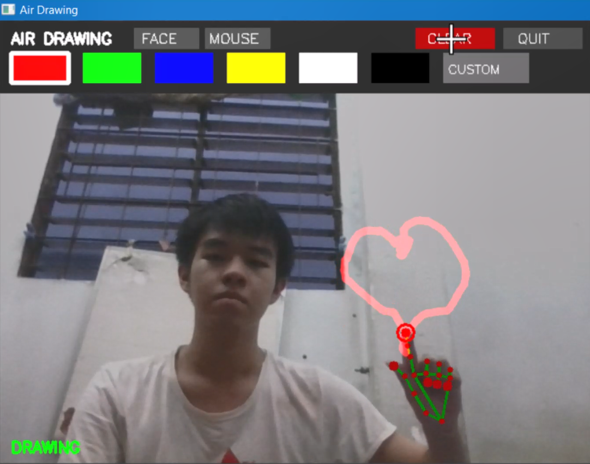
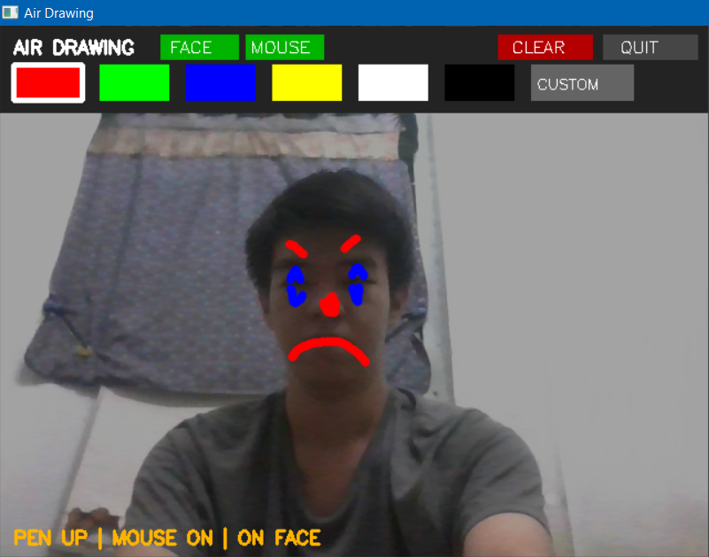
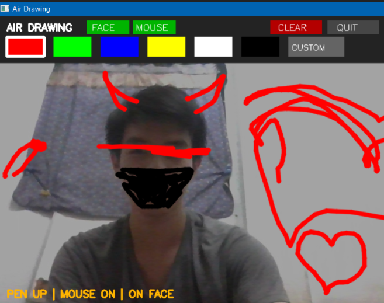

# BÀI TẬP MÔN HỌC: XÂY DỰNG ỨNG DỤNG TƯƠNG TÁC VỚI CAMERA SỬ DỤNG MEDIAPIPE

**Tên đề tài:** Air Drawing & AR Face Filter (Ứng Dụng Vẽ Tương Tác Không Chạm và Bộ Lọc Thực Tế Ảo Trên Mặt Tự Động Định Vị)
**Sinh viên thực hiện:** Phan Thanh Bình
**Mã số sinh viên:** 26520184
**Lớp:** ATTN2026

---

## HÌNH ẢNH DEMO MINH HỌA

*Dưới đây là 3 hình ảnh thực nghiệm minh họa cho ứng dụng:*


*(Chú thích: Vẽ trên không bằng ngón tay trỏ với thanh công cụ đổi màu)*


*(Chú thích: Nét vẽ dính lên khuôn mặt và di chuyển theo đầu)*


*(Chú thích: Sử dụng chuột để vẽ, trang điểm lên mặt)*

---

## THÔNG TIN BÀI NỘP

- **Link Video Demo:** [https://youtu.be/WAxciz-K0cQ]
- **Danh sách thư viện cần thiết:** 
  - `Python >= 3.9`
  - `mediapipe >= 1.1.1`
  - `opencv-python >= 4.8.0`
  - `numpy >= 1.24.0`
  - `tkinter`
- **Hướng dẫn sử dụng:**
  - Co/nắm tay để di chuyển tự do mà không vẽ, duỗi thẳng ngón trỏ để vẽ.
  - Bật chế độ face để những hình vẽ ấy di chuyển theo khuôn mặt.
  - Bật chế độ mouse để hỗ trợ dùng chuột vẽ.
---

## HƯỚNG DẪN CÀI ĐẶT VÀ CHẠY CHƯƠNG TRÌNH


**1. Cài đặt thư viện:**
```bash
pip install mediapipe opencv-python numpy
```


**2. Tải file Model:**

Tải 2 file sau từ Google MediaPipe và để cùng thư mục với file code (em có để bên trong respiratory github):
- hand_landmarker.task
- face_landmarker.task


**3. Chạy chương trình:**
```bash
python main.py
```
